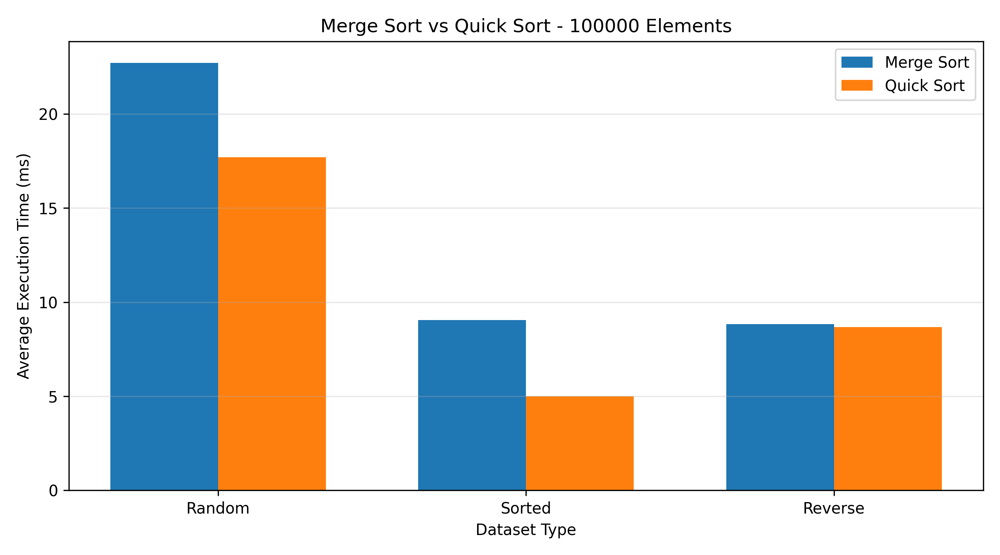

# Sorting Algorithms Analysis

**Merge Sort vs. Quick Sort | Java**

Shaqra University — Design and Analysis of Algorithms

## Overview
A team project implementing, verifying and comparing two divide-and-conquer sorting algorithms, with interactive Swing visualizers for both algorithms.

## Run the project
From the repository root, with a JDK installed:

```sh
javac -encoding UTF-8 -d out src/MergeSort.java src/QuickSort.java src/MergeSortVisualizer.java src/QuickSortVisualizer.java src/SortingVisualizer.java benchmark/MergeSortBenchmark.java benchmark/SortingBenchmark.java
java -cp out MergeSort
java -cp out QuickSort
java -cp out SortingVisualizer
java -cp out MergeSortVisualizer
java -cp out QuickSortVisualizer
java -cp out MergeSortBenchmark
java -cp out SortingBenchmark
```

The comparison benchmark overwrites `results/results.csv`. Preserve the recorded results before rerunning if needed. To regenerate charts, install matplotlib and run `python results/plot_results.py`.

## Recorded comparison
Both algorithms were tested on random, sorted and reverse inputs of 1,000, 10,000 and 100,000 elements. Quick Sort was faster in seven of nine recorded cases; Merge Sort was faster for random 1,000 and reverse 10,000. These are experimental observations, not universal guarantees.



[Recorded CSV](results/results.csv) · [1,000 elements](results/sorting_comparison_1000.png) · [10,000 elements](results/sorting_comparison_10000.png)

## Repository layout
- `src/` — canonical algorithms and visualizer
- `benchmark/` — standalone and comparative experiments
- `results/` — recorded measurements, charts and plotting script
- `screenshots/testing/` — experiment evidence
- `docs/` — individual documentation and pseudocode

## Team contributions
- Deem — Merge Sort, standalone benchmark and visualizer
- Aseel — Quick Sort and algorithm documentation
- Hanan — comparative benchmark, results and charts

Original feature branches retain the original submissions. Standalone benchmark timings should not be compared directly with the controlled comparative experiment.

## Interactive visualization
Launch `SortingVisualizer` to switch between Merge Sort and Quick Sort using the same controls and palette. Quick Sort traces median-of-three pivot selection, Lomuto comparisons, swaps and final pivot placement. Both visualizers use separate educational traces, not timed benchmark execution.
